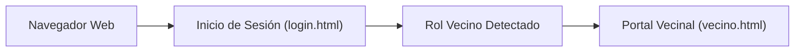
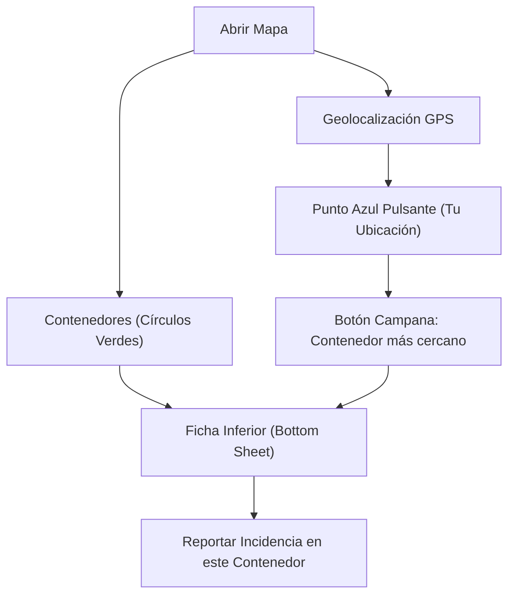
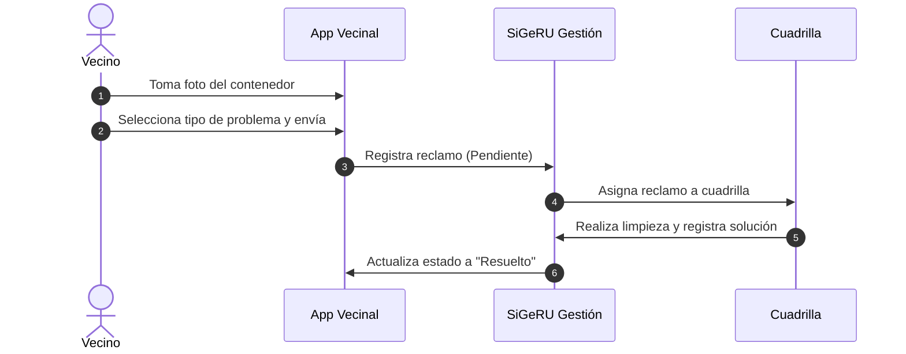

# Manual de Usuario — Portal Vecinal SiGeRU

**Sistema de Gestión de Residuos Urbanos de Montevideo (SiGeRU)**  
*Guía oficial de uso para el ciudadano y vecino*

---

## 1. Introducción y Propósito

El **Portal Vecinal de SiGeRU** es una plataforma ciudadana diseñada bajo el concepto *Mobile-First*, accesible desde cualquier teléfono inteligente, tablet o computadora. Permite a los vecinos:
- **Localizar contenedores de residuos** en tiempo real sobre un mapa interactivo.
- **Consultar la distancia** hasta el contenedor más cercano mediante geolocalización GPS.
- **Reportar incidencias** (desbordes, roturas, basura acumulada, riesgos sanitarios) adjuntando fotografías tomadas en el momento.
- **Monitorear el avance** de sus solicitudes hasta que la cuadrilla de limpieza atienda el reporte.

---

## 2. Acceso a la Plataforma



1. **Ingreso:** Abra el navegador web e ingrese a la dirección:  
   `http://localhost/UTU/Nueva%20carpeta/SiGeRu-Website/landing-page/login.html`
2. **Credenciales:** Introduzca su correo electrónico y contraseña.
3. Al validar su cuenta con rol de vecino, el sistema lo dirigirá automáticamente a la aplicación: [vecino.html](frontend-usuarios/vecino.html).

---

## 3. Estructura de la Aplicación

La interfaz está organizada para facilitar la navegación con una sola mano en dispositivos móviles:

```
┌────────────────────────────────────────────────────────┐
│ [Logo] SiGeRU | Vecino           [Nombre] [☀️/🌙] [🚪]  │ <- Encabezado superior
├────────────────────────────────────────────────────────┤
│                                                        │
│                                                        │
│                PANTALLA ACTIVA                         │
│       • Mapa Interactivo                               │
│       • Tus Reclamos                                   │
│       • Perfil Ciudadano                               │
│                                                        │
│                                                        │
├────────────────────────────────────────────────────────┤
│   [👤 Perfil]     [ 📷 Reportar ]     [🗺️ Mapa]   [📋 Reclamos]│ <- Barra de navegación inferior
└────────────────────────────────────────────────────────┘
```

### 3.1. Barra Superior
- **Identificación:** Muestra el nombre del vecino activo.
- **Selector de Tema (`☀️ / 🌙`):** Permite cambiar entre modo claro y modo oscuro.
- **Cerrar Sesión (`🚪`):** Cierra la sesión de forma segura y regresa al login.

### 3.2. Barra Inferior de Navegación
- **Perfil (`👤`):** Datos del vecino y cantidad de reportes efectuados.
- **Botón Flotante Central (`📷`):** Disparador rápido para tomar foto y reportar.
- **Mapa (`🗺️`):** Mapa interactivo de contenedores (pantalla de inicio).
- **Reclamos (`📋`):** Bandeja de seguimiento de incidencias reportadas.

---

## 4. Uso del Mapa Interactivo



### 4.1. Elementos Visuales
- **Círculos verdes (`🗑️`):** Contenedores ubicados en la vía pública.
- **Punto azul pulsante:** Representa su ubicación actual en vivo.
- **Círculo azul traslúcido:** Área de precisión estimada por su GPS.

### 4.2. Controles Flotantes del Mapa
- **Botón Mi Ubicación (`🎯` - Mira azul):** Centra la cámara en su posición GPS.
- **Botón Contenedor más Cercano (`🔔` - Campana amarilla):** Identifica el contenedor más próximo mediante cálculo geométrico de distancia y lo enfoca en el mapa.

### 4.3. Ficha Desplegable (*Bottom Sheet*)
Al tocar un contenedor o pulsar la campana, se desplegará una tarjeta con:
- Código identificador (ejemplo: `CH-CONT-101`).
- Tipo de contenedor (General, Reciclable, etc.).
- Dirección (calle, esquina y barrio).
- Distancia en metros respecto a su ubicación.
- Botón verde **"Reportar incidencia en este contenedor"**.

---

## 5. Reporte de Incidencias y Reclamos

### 5.1. Vías para Iniciar un Reporte
1. **Desde un contenedor específico:** Tocando el contenedor en el mapa y seleccionando *Reportar incidencia*.
2. **Acceso directo:** Pulsando el botón central redondo con ícono de **Cámara (`📷`)** en la barra inferior.

### 5.2. Formulario de Reclamo



1. **Fotografía (Cámara / Galería):**
   - Pulse **"Tomar foto o subir imagen"**.
   - Capture el estado del contenedor con su cámara.
   - Si la imagen no es clara, use el botón **"Eliminar foto"** y capture una nueva.
2. **Tipo de Problema:**
   - *Contenedor Desbordado*
   - *Contenedor Roto / Dañado*
   - *Residuos fuera del contenedor*
   - *Demora en la recolección*
   - *Riesgo sanitario / Contaminación*
3. **Ubicación:**
   - Barrio, calle y esquina (se autocompletan si seleccionó un contenedor en el mapa).
4. **Comentario adicional:**
   - Ingrese cualquier observación relevante (ej. *tapa trabada, restos de poda, etc.*).
5. **Confirmación:**
   - Presione **"Generar reclamo"**. El reporte quedará registrado inmediatamente en la base central.

---

## 6. Seguimiento de Reclamos ("Tus Reclamos")

En la pestaña **Reclamos (`📋`)** encontrará todas las incidencias que ha reportado, ordenadas cronológicamente con su estado de avance:

### 6.1. Ciclo de Vida del Reclamo

| Estado | Distintivo | Significado |
| :--- | :---: | :--- |
| **Pendiente de asignación** | 🟡 Amarillo / Gris | El reporte ingresó al sistema y está en espera de programación operativa. |
| **Cuadrilla asignada** | 🔵 Azul | Se asignó una cuadrilla o camión que está en tránsito o trabajando en el lugar. |
| **Resuelto / Atendido** | 🟢 Verde | El problema fue subsanado satisfactoriamente por el personal municipal. |

### 6.2. Detalle de Reclamo
Al presionar sobre cualquier tarjeta de la lista, se abrirá la ventana informativa:
- Código de reclamo y fecha de emisión.
- Ubicación detallada y descripción enviada.
- Fotografía original adjunta.
- **Solución aplicada:** Texto emitido por la cuadrilla al finalizar las tareas (ej. *"Vaciado de contenedor realizado y barrido perimetral completado"*).

---

## 7. Módulo de Perfil Ciudadano

En la pestaña **Perfil (`👤`)** puede verificar su información registrada:
- **Nombre completo** y **Cédula de Identidad**.
- **Teléfono de contacto** y **Dirección de residencia**.
- **Contador de reclamos:** Muestra el número total de reportes que ha generado, destacando su compromiso con la limpieza urbana.

---

## 8. Preguntas Frecuentes y Soporte

- **¿Por qué la aplicación me solicita permisos de ubicación?**  
  Para mostrarle en el mapa dónde se encuentra usted en relación a los contenedores y calcular la distancia hacia el más cercano.
- **¿Qué hago si no tengo conexión a internet en el momento?**  
  Puede tomar la fotografía con la cámara habitual de su teléfono y, al recuperar la conexión, ingresar al portal y adjuntarla seleccionando "Tomar foto o subir imagen" desde la galería.
- **¿Puedo reportar basura fuera del contenedor?**  
  Sí. Seleccione la opción *"Residuos fuera del contenedor"* y describa si se trata de poda, escombros o residuos voluminosos para que se despache el vehículo adecuado.

